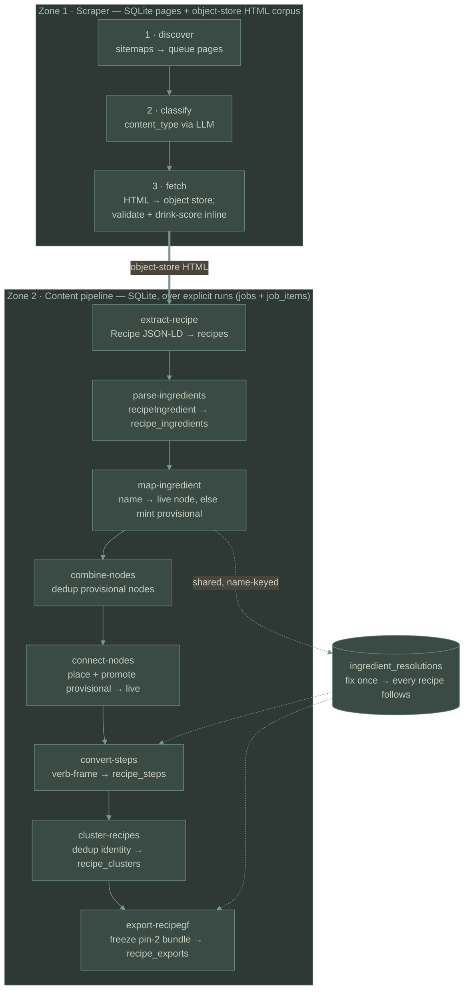

# Pipeline — data flow

The pipeline runs in two zones. **Zone 1** (the `scraper/` package — SQLite plus
the object-store HTML corpus) crawls the web into two durable inputs: per-URL `pages` state
and the write-once HTML corpus. **Zone 2** (the `ingredients/` package —
SQLite, inside the service process) turns those into the relational recipe and its published RecipeGF
bundle.

Every Zone-2 stage is a `stage_fn` over the `stage_runs` work queue: a stage's
queue is "content qualifies AND has no run at the current version," so a re-run
only touches what a prior run left undone. Zone-2 stages run two ways — one-off
and deterministically via the CLI (`ingredients.cli <stage>` / `cold-build`, where `<stage>` is one of `extract-recipe`, `parse-ingredients`, `map-ingredient`, `combine-nodes`, `connect-nodes`, `convert-steps`, `cluster-recipes`, `export-recipegf`), or
continuously via the worker daemon off the `jobs` queue (which adds the LLM
provider tiers and a per-job cost cap). Command surface and versioning live in
[CLAUDE.md](../CLAUDE.md).



Between mapping and step conversion sit two **taxonomy-harmonization**
stages, both keyed on the `taxonomy_node` entity. `map-ingredient` resolves
a name to an existing **live** node or, on abstain, mechanically mints a
`provisional` stub (deterministic slug, no parent, no LLM). `combine-nodes`
then dedups those stubs against each other and the live set, and
`connect-nodes` places each survivor (kind + parents + `is_cluster_node`)
and flips it `provisional → live`; uncertain cases in either stage open a
`human_reviews` row and leave the node provisional. Downstream stages —
`convert-steps`, `cluster-recipes`, `export-recipegf` — treat a recipe with
any still-`provisional` ingredient node as `pending` and emit nothing for it
until its nodes are promoted, so provisional nodes never reach a cluster,
a step set, an export, or the public views.

Only the fetched HTML corpus and the `pages` rows are the crawl's durable
output; everything downstream regenerates from them, so any stage is safe to
re-run (delete its `stage_runs` rows, or bump the stage's version constant). The
consumer-facing RecipeGF bundle is itself a projection — generated on demand from
the relational rows and frozen into `recipe_exports` only on export; see
[recipegf-export.md](recipegf-export.md).

## Smoke-testing an LLM tier

Every Zone-2 LLM tier speaks one packed contract: the chain sends
`{"items": [{"id", "input"}]}` under `ENVELOPE_INSTRUCTIONS` + the stage's
prompt (`common/providers/packing.py`), and reads back
`{"results": [{"id", "answer"}]}`. Unit tests cover that contract
(`ingredients/tests/test_llm_contract.py`) but no cloud session has an API key,
so a tier counts as working only after a run against a real model.

**Headless (preferred).** On a machine with the scraper's HTML cache
(`data/html` + `data/scraper.db`; barbot) and an LLM key:

```bash
scripts/preview.sh --smoke <branch>                       # deepseek, 20 map recipes + 5 extract pages, 50¢ cap
scripts/preview.sh --smoke --provider openai --extract 0 <branch>
```

It copies a local snapshot of the live database (`data/live-snapshot.db`) into
a scratch file, runs `python -m ingredients.smoke` there (the same runs `/ops`
would build, executed through the real executor path), prints a markdown report
and saves it under `data/`, then deletes the copy. extract-recipe reads page
HTML from the scraper's cache (`CORPUS_DIR`, see
`ingredients.pipeline.corpus.LocalCorpusReader`) instead of the bucket. The map
residue is recipes with an ingredient the deterministic tiers left
`provisional`/`abstain`; the extract sample is pages whose last extract
abstained (no Recipe JSON-LD), `confirmed_drink` pages first so it hits real
recipes rather than hub pages.

**In the browser.** `scripts/preview.sh <branch>` serves the same kind of copy
at `http://<host>:8000`; open `/api/auth/dev-login` to sign in without a passkey
(`DEV_LOGIN`, honoured on plain-http origins only), then assemble runs in
`/ops` as usual. Queued runs inherited from the snapshot are cancelled first so
the preview never spends on them. Ctrl-C cleans up.

**Secrets.** The preview machine holds no prod credentials: `scripts/preview.env`
lists only the LLM keys (1Password references for `op run`), or
`PREVIEW_ENV_FILE` names a private file of plain values. Get the snapshot from
`/ops → Import → Download database` (`GET /api/ops/export-db`, a `VACUUM INTO`
copy of the live file) and copy it to `data/live-snapshot.db`. Before that
button is deployed, the cold-start path needs the replica bucket's credentials,
so run it where you hold those (your laptop) and copy the file over:

```bash
scripts/fetch-snapshot.sh                                 # litestream restore → data/live-snapshot.db
scp data/live-snapshot.db barbot:code-projects/spiritolo/data/
```

`fetch-snapshot.sh` reads `LITESTREAM_*` from the environment, or resolves
`scripts/snapshot.env` through `op run`. It only restores, never replicates.

What a failure looks like in the report:

- The run ends `failed` with `error_code = 'provider_unavailable'` and an
  `error_detail` naming the provider and HTTP status (`deepseek error 400: …`):
  a request the API rejected. `stage_error` is a bug in the stage itself; its
  `error_detail` carries the traceback.
- The run ends `done` with zero names attached by the model and a non-zero
  cost: replies came back in a shape the envelope decoder couldn't read. Look
  for `LLM pack … failed` lines in the output.

## Local LLM tier (LM Studio on barbot)

The free `local` LLM tier is any **OpenAI-compatible** server: the executor
posts to `<LOCAL_LLM_BASE_URL>/v1/chat/completions` and knows nothing about
which runtime answers ([providers_local.py](../ingredients/src/ingredients/worker/providers_local.py)).
Barbot, the GPU box on the tailnet, runs LM Studio, so that is the setup below;
an Ollama host works the same way at port 11434. Runs assembled before this
tier carry `llm_provider = 'ollama'`, which is still accepted as an alias for
`local`.

| Variable (Railway, plain) | Meaning |
|---|---|
| `LOCAL_LLM_BASE_URL` | Server root, without `/v1`: `http://barbot:1234` (LM Studio) or `http://barbot:11434` (Ollama). Falls back to `OLLAMA_BASE_URL` for one release, then to `http://localhost:1234`. |
| `LOCAL_LLM_MODEL` | Model a `local` run uses when it names none, in the runtime's own naming (LM Studio `qwen/qwen3-14b`, Ollama `qwen3:14b`). |
| `LOCAL_LLM_REASONING_EFFORT` | Sent as `reasoning_effort`; default `none` (thinking off, see *Thinking* below). Empty string omits it. |
| `LOCAL_LLM_EXTRA_BODY` | Optional JSON object merged into every request, for runtime-specific switches (see *Thinking* below). |
| `TAILSCALE_AUTHKEY` (vault) | Joins the container to the tailnet; the entrypoint then sets `TS_LOCAL_PROXY`, and only the local client uses it. |

The client also adapts two request details so the stock OpenAI provider works
against either runtime: `response_format: json_object`, which LM Studio
rejects, is sent as a JSON schema for "any object", and `max_completion_tokens`
is mirrored to `max_tokens`. Its timeout is 10 minutes, since the first request
for a model may wait for it to load.

### Setting up barbot

1. **Install LM Studio** and its `lms` CLI (the app installs it; `lms --help`
   lists the commands your version has).
2. **Run it headless at boot.** Start the background service with
   `lms daemon up` (the headless "llmster" daemon) from a startup task, so the
   server is up without anyone logging in, then `lms server start`. Check with
   `lms status`.
3. **Serve on the tailnet.** In *Developer → Server Settings*, enable *Serve on
   Local Network* so the server listens beyond `localhost`, and keep the port
   at 1234. Barbot's Tailscale ACL must let `tag:worker` (the Railway
   container's tag, see `scripts/entrypoint.sh`) reach `barbot:1234`.
4. **Enable JIT loading** (*Just-in-Time Model Loading*) and *Auto unload unused
   JIT loaded models* with an idle TTL (e.g. 30 minutes). A run then loads its
   model on the first request and frees the VRAM after it.
5. **Download the model** in the app or with `lms get <model>`, and copy its id
   from `lms ls` (or `curl http://barbot:1234/v1/models`) into `LOCAL_LLM_MODEL`.
6. **If Ollama stays installed**, set `OLLAMA_KEEP_ALIVE=0` on barbot so it
   never holds VRAM while LM Studio needs it.

**Check from any tailnet machine:**
`curl http://barbot:1234/v1/models` lists the downloaded models, then a `local`
run of a few items in `/ops` should end with items `applied`.

### Thinking

A thinking model spends its token budget reasoning before it answers; with the
2048-token cap the visible answer can come back empty. The local client
therefore sends `reasoning_effort: "none"` on every request
(`LOCAL_LLM_REASONING_EFFORT`; set it to an empty string to omit the field for
a runtime that rejects it). Tested on barbot 2026-10-30 with LM Studio and
Qwen3.5 9B: `reasoning_effort: "none"` gives zero reasoning tokens and a clean
JSON answer, while `chat_template_kwargs: {"enable_thinking": false}` and
`reasoning: {"effort": "none"}` are ignored (the model thinks through the whole
budget and returns empty content; see also
[lmstudio-bug-tracker#1990](https://github.com/lmstudio-ai/lmstudio-bug-tracker/issues/1990)).
LM Studio returns any reasoning separately in `reasoning_content`, never inside
`content`. `LOCAL_LLM_EXTRA_BODY` stays available for other runtime flags.

### Barbot as configured (2026-10-30)

Barbot's LM Studio engine is shared with the forecash project and set up by
that repo (`forecash/docs/lms-on-barbot.md`): a headless `llmster` in a
network-less firejail, with `socat` forwarding port 1234 on `127.0.0.1` and
the Tailscale IP. Spiritolo uses it as is:

- Endpoint `http://100.91.131.62:1234` (`barbot.dace-barb.ts.net`; the bare
  name `barbot` needs MagicDNS on the client). Not exposed on the LAN.
- Model `qwen3.5-9b` (Qwen3.5 9B, Q8_0, about 9 GB of VRAM once loaded on the
  16 GB RTX 4060 Ti). The jail cannot download, so models are fetched into
  `~/.lmstudio/models/` by hand, not with `lms get`.
- JIT loading on, idle TTL 5 minutes (`developer.jitModelTTL` in
  `~/.lmstudio/settings.json`), previous JIT model unloaded on a new load. A
  cold first request loads the model in about 15 s.
- The GPU fits one model at a time: if forecash or another LM Studio holds a
  model, a JIT load of `qwen3.5-9b` may not fit.
- The engine does **not** start at boot. After a reboot run
  `~/code-projects/forecash/scripts/lms-ros.sh up`.
