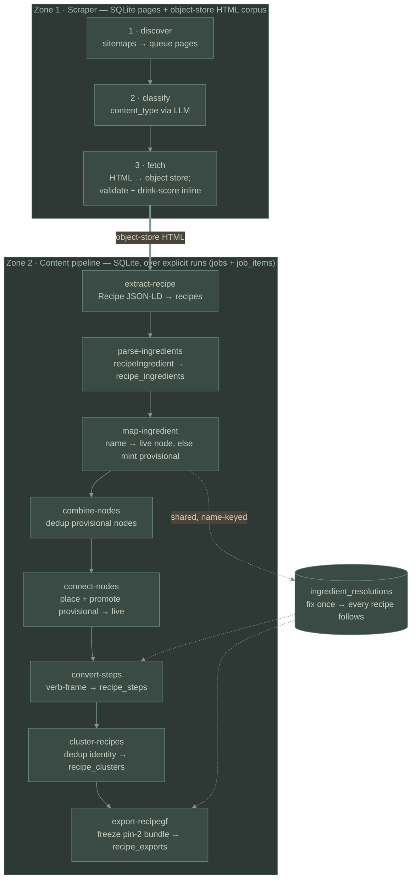

# Pipeline — data flow

The pipeline runs in two zones. **Zone 1** (the `scraper/` package — SQLite plus
the object-store HTML corpus) crawls the web into two durable inputs: per-URL `pages` state
and the write-once HTML corpus. **Zone 2** (the `ingredients/` package —
SQLite, inside the service process) turns those into the relational recipe and its published RecipeGF
bundle.

Every Zone-2 stage is a `stage_fn` over the `stage_runs` work queue: a stage's
queue is "content qualifies AND has no run at the current version," so a re-run
only touches what a prior run left undone. Zone-2 stages run two ways — one-off
and deterministically via the CLI (`ingredients.cli <stage>` / `cold-build`, where `<stage>` is one of `extract-recipe`, `parse-ingredients`, `map-ingredient`, `combine-nodes`, `connect-nodes`, `convert-steps`, `cluster-recipes`, `export-recipegf`), or
continuously via the worker daemon off the `jobs` queue (which adds the LLM
provider tiers and a per-job cost cap). Command surface and versioning live in
[CLAUDE.md](../CLAUDE.md).



Between mapping and step conversion sit two **taxonomy-harmonization**
stages, both keyed on the `taxonomy_node` entity. `map-ingredient` resolves
a name to an existing **live** node or, on abstain, mechanically mints a
`provisional` stub (deterministic slug, no parent, no LLM). `combine-nodes`
then dedups those stubs against each other and the live set, and
`connect-nodes` places each survivor (kind + parents + `is_cluster_node`)
and flips it `provisional → live`; uncertain cases in either stage open a
`human_reviews` row and leave the node provisional. Downstream stages —
`convert-steps`, `cluster-recipes`, `export-recipegf` — treat a recipe with
any still-`provisional` ingredient node as `pending` and emit nothing for it
until its nodes are promoted, so provisional nodes never reach a cluster,
a step set, an export, or the public views.

Only the fetched HTML corpus and the `pages` rows are the crawl's durable
output; everything downstream regenerates from them, so any stage is safe to
re-run (delete its `stage_runs` rows, or bump the stage's version constant). The
consumer-facing RecipeGF bundle is itself a projection — generated on demand from
the relational rows and frozen into `recipe_exports` only on export; see
[recipegf-export.md](recipegf-export.md).

## Smoke-testing an LLM tier

Every Zone-2 LLM tier speaks one packed contract: the chain sends
`{"items": [{"id", "input"}]}` under `ENVELOPE_INSTRUCTIONS` + the stage's
prompt (`common/providers/packing.py`), and reads back
`{"results": [{"id", "answer"}]}`. Unit tests cover that contract
(`ingredients/tests/test_llm_contract.py`) but no cloud session has an API key,
so a tier counts as working only after a run against a real model.

**Headless (preferred).** On a machine with the scraper's HTML cache
(`data/html` + `data/scraper.db`; barbot) and an LLM key:

```bash
scripts/preview.sh --smoke <branch>                       # deepseek, 20 map recipes + 5 extract pages, 50¢ cap
scripts/preview.sh --smoke --provider openai --extract 0 <branch>
```

It copies a local snapshot of the live database (`data/live-snapshot.db`) into
a scratch file, runs `python -m ingredients.smoke` there (the same runs `/ops`
would build, executed through the real executor path), prints a markdown report
and saves it under `data/`, then deletes the copy. extract-recipe reads page
HTML from the scraper's cache (`CORPUS_DIR`, see
`ingredients.pipeline.corpus.LocalCorpusReader`) instead of the bucket. The map
residue is recipes with an ingredient the deterministic tiers left
`provisional`/`abstain`; the extract sample is pages whose last extract
abstained (no Recipe JSON-LD).

**In the browser.** `scripts/preview.sh <branch>` serves the same kind of copy
at `http://<host>:8000`; open `/api/auth/dev-login` to sign in without a passkey
(`DEV_LOGIN`, honoured on plain-http origins only), then assemble runs in
`/ops` as usual. Queued runs inherited from the snapshot are cancelled first so
the preview never spends on them. Ctrl-C cleans up.

**Secrets.** The preview machine holds no prod credentials: `scripts/preview.env`
lists only the LLM keys (1Password references for `op run`), or
`PREVIEW_ENV_FILE` names a private file of plain values. The snapshot is the
one thing that needs the replica bucket's credentials, so fetch it where you
hold those (your laptop) and copy it over:

```bash
scripts/fetch-snapshot.sh                                 # litestream restore → data/live-snapshot.db
scp data/live-snapshot.db barbot:code-projects/spiritolo/data/
```

`fetch-snapshot.sh` reads `LITESTREAM_*` from the environment, or resolves
`scripts/snapshot.env` through `op run`. It only restores, never replicates.

What a failure looks like in the report:

- The run ends `failed` with `error_code = 'provider_unavailable'` and an
  `error_detail` naming the provider and HTTP status (`deepseek error 400: …`):
  a request the API rejected. `stage_error` is a bug in the stage itself; its
  `error_detail` carries the traceback.
- The run ends `done` with zero names attached by the model and a non-zero
  cost: replies came back in a shape the envelope decoder couldn't read. Look
  for `LLM pack … failed` lines in the output.
