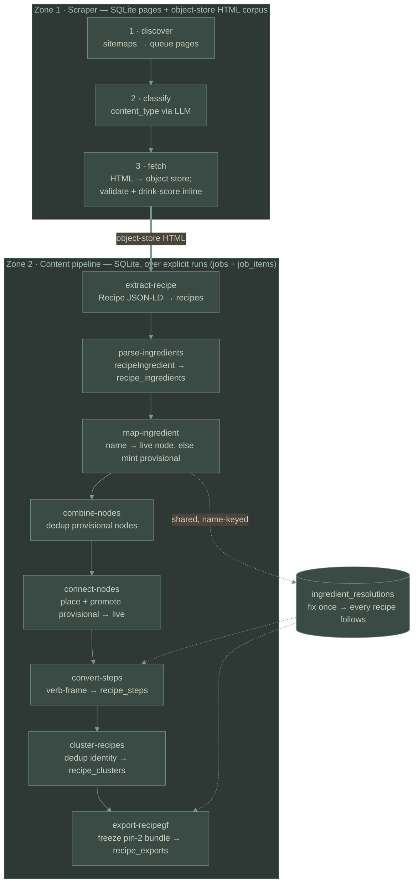

# Pipeline — data flow

The pipeline runs in two zones. **Zone 1** (the `scraper/` package — SQLite plus
the object-store HTML corpus) crawls the web into two durable inputs: per-URL `pages` state
and the write-once HTML corpus. **Zone 2** (the `ingredients/` package —
SQLite, inside the service process) turns those into the relational recipe and its published RecipeGF
bundle.

Every Zone-2 stage is a `stage_fn` over the `stage_runs` work queue: a stage's
queue is "content qualifies AND has no run at the current version," so a re-run
only touches what a prior run left undone. Zone-2 stages run two ways — one-off
and deterministically via the CLI (`ingredients.cli <stage>` / `cold-build`, where `<stage>` is one of `extract-recipe`, `parse-ingredients`, `map-ingredient`, `combine-nodes`, `connect-nodes`, `convert-steps`, `cluster-recipes`, `export-recipegf`), or
continuously via the worker daemon off the `jobs` queue (which adds the LLM
provider tiers and a per-job cost cap). Command surface and versioning live in
[CLAUDE.md](../CLAUDE.md).

Between mapping and step conversion sit two **taxonomy-harmonization**
stages, both keyed on the `taxonomy_node` entity. `map-ingredient` resolves
a name to an existing **live** node or, on abstain, mechanically mints a
`provisional` stub (deterministic slug, no parent, no LLM). `combine-nodes`
then dedups those stubs against each other and the live set, and
`connect-nodes` places each survivor (kind + parents + `is_cluster_node`)
and flips it `provisional → live`; uncertain cases in either stage open a
`human_reviews` row and leave the node provisional. Downstream stages —
`convert-steps`, `cluster-recipes`, `export-recipegf` — treat a recipe with
any still-`provisional` ingredient node as `pending` and emit nothing for it
until its nodes are promoted, so provisional nodes never reach a cluster,
a step set, an export, or the public views.

Only the fetched HTML corpus and the `pages` rows are the crawl's durable
output; everything downstream regenerates from them, so any stage is safe to
re-run (delete its `stage_runs` rows, or bump the stage's version constant). The
consumer-facing RecipeGF bundle is itself a projection — generated on demand from
the relational rows and frozen into `recipe_exports` only on export; see
[recipegf-export.md](recipegf-export.md).

## Local LLM tier (LM Studio on barbot)

The free `local` LLM tier is any **OpenAI-compatible** server: the executor
posts to `<LOCAL_LLM_BASE_URL>/v1/chat/completions` and knows nothing about
which runtime answers ([providers_local.py](../ingredients/src/ingredients/worker/providers_local.py)).
Barbot, the GPU box on the tailnet, runs LM Studio, so that is the setup below;
an Ollama host works the same way at port 11434. Runs assembled before this
tier carry `llm_provider = 'ollama'`, which is still accepted as an alias for
`local`.

| Variable (Railway, plain) | Meaning |
|---|---|
| `LOCAL_LLM_BASE_URL` | Server root, without `/v1`: `http://barbot:1234` (LM Studio) or `http://barbot:11434` (Ollama). Falls back to `OLLAMA_BASE_URL` for one release, then to `http://localhost:1234`. |
| `LOCAL_LLM_MODEL` | Model a `local` run uses when it names none, in the runtime's own naming (LM Studio `qwen/qwen3-14b`, Ollama `qwen3:14b`). |
| `LOCAL_LLM_EXTRA_BODY` | Optional JSON object merged into every request, for runtime-specific switches (see *Thinking* below). |
| `TAILSCALE_AUTHKEY` (vault) | Joins the container to the tailnet; the entrypoint then sets `TS_LOCAL_PROXY`, and only the local client uses it. |

The client also adapts two request details so the stock OpenAI provider works
against either runtime: `response_format: json_object`, which LM Studio
rejects, is sent as a JSON schema for "any object", and `max_completion_tokens`
is mirrored to `max_tokens`. Its timeout is 10 minutes, since the first request
for a model may wait for it to load.

### Setting up barbot

1. **Install LM Studio** and its `lms` CLI (the app installs it; `lms --help`
   lists the commands your version has).
2. **Run it headless at boot.** Start the background service with
   `lms daemon up` (the headless "llmster" daemon) from a startup task, so the
   server is up without anyone logging in, then `lms server start`. Check with
   `lms status`.
3. **Serve on the tailnet.** In *Developer → Server Settings*, enable *Serve on
   Local Network* so the server listens beyond `localhost`, and keep the port
   at 1234. Barbot's Tailscale ACL must let `tag:worker` (the Railway
   container's tag, see `scripts/entrypoint.sh`) reach `barbot:1234`.
4. **Enable JIT loading** (*Just-in-Time Model Loading*) and *Auto unload unused
   JIT loaded models* with an idle TTL (e.g. 30 minutes). A run then loads its
   model on the first request and frees the VRAM after it.
5. **Download the model** in the app or with `lms get <model>`, and copy its id
   from `lms ls` (or `curl http://barbot:1234/v1/models`) into `LOCAL_LLM_MODEL`.
6. **If Ollama stays installed**, set `OLLAMA_KEEP_ALIVE=0` on barbot so it
   never holds VRAM while LM Studio needs it.

**Check from any tailnet machine:**
`curl http://barbot:1234/v1/models` lists the downloaded models, then a `local`
run of a few items in `/ops` should end with items `applied`.

### Thinking

Qwen3 thinks by default, which burns tokens on these structured prompts. The
old Ollama client sent `think: false`; `/v1/chat/completions` has no portable
switch, so it is per runtime: turn thinking off in LM Studio's model settings
for that model, or put the runtime's request flag in `LOCAL_LLM_EXTRA_BODY`
(for servers that honour chat-template kwargs that is
`{"chat_template_kwargs": {"enable_thinking": false}}`). The recipe that
works on barbot is not recorded yet: record it here once tested.
